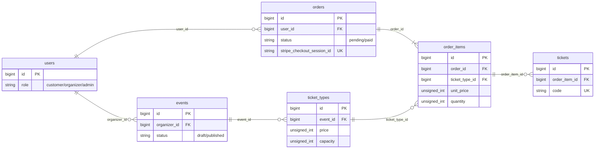

# データベース設計

## ER 図



## カラム定義

### users（既存テーブルに追加）

| カラム | 型 | 制約 | 説明 |
|-|-|-|-|
| role | string(20) | NOT NULL, default `customer`, index | `customer` / `organizer` / `admin`。PHP の Enum にする |

### events

| カラム | 型 | 制約 | 説明 |
|-|-|-|-|
| id | bigint unsigned | PK | |
| organizer_id | bigint unsigned | NOT NULL, FK → users.id | 主催者 |
| title | string(255) | NOT NULL | イベント名 |
| description | text | NULL 可 | 説明 |
| venue | string(255) | NOT NULL | 会場 |
| starts_at | datetime | NOT NULL, index | 開催日時。一覧の並び順と「開催済みを除く」に使う |
| status | string(20) | NOT NULL, default `draft`, index | `draft` / `published` |
| created_at / updated_at | timestamp | | |

### ticket_types（券種）

| カラム | 型 | 制約 | 説明 |
|-|-|-|-|
| id | bigint unsigned | PK | |
| event_id | bigint unsigned | NOT NULL, FK → events.id, index | |
| name | string(100) | NOT NULL | 券種名（一般、学生など） |
| price | unsigned integer | NOT NULL | 価格（円、整数）。0 円も可 |
| capacity | unsigned integer | NOT NULL | 定員（この券種の総枚数） |
| sales_start_at | datetime | NOT NULL | 販売開始 |
| sales_end_at | datetime | NOT NULL | 販売終了。`sales_start_at` 以降であることをバリデーションで確認 |
| created_at / updated_at | timestamp | | |

### orders

| カラム | 型 | 制約 | 説明 |
|-|-|-|-|
| id | bigint unsigned | PK | |
| user_id | bigint unsigned | NOT NULL, FK → users.id, index | 注文者 |
| status | string(20) | NOT NULL, default `pending`, index | `pending`（支払い待ち）/ `paid`（支払い済み） |
| total_amount | unsigned integer | NOT NULL | 注文時点の合計金額（円）。明細の合計と同じ値を保存 |
| stripe_checkout_session_id | string(255) | NULL 可, UNIQUE | Checkout Session の ID。Checkout 作成後にセットするので NULL 可。Webhook で注文を特定するキー |
| paid_at | datetime | NULL 可 | 支払い確定日時 |
| created_at / updated_at | timestamp | | |

### order_items（注文明細）

| カラム | 型 | 制約 | 説明 |
|-|-|-|-|
| id | bigint unsigned | PK | |
| order_id | bigint unsigned | NOT NULL, FK → orders.id | |
| ticket_type_id | bigint unsigned | NOT NULL, FK → ticket_types.id, index | |
| unit_price | unsigned integer | NOT NULL | 注文時点の単価（円）。券種の価格が変わっても動かない |
| quantity | unsigned integer | NOT NULL | 枚数（1 以上） |
| created_at / updated_at | timestamp | | |

- `(order_id, ticket_type_id)` に UNIQUE を付ける。同じ券種は1注文1行にまとめる。

### tickets

| カラム | 型 | 制約 | 説明 |
|-|-|-|-|
| id | bigint unsigned | PK | |
| order_item_id | bigint unsigned | NOT NULL, FK → order_items.id, index | どの明細の1枚か |
| code | string(26) | NOT NULL, UNIQUE | 1枚ずつ固有のコード。ULID（`Str::ulid()`） |
| created_at / updated_at | timestamp | | |

## 外部キーの削除時の動き

| 外部キー | 動き | 理由 |
|-|-|-|
| events.organizer_id → users | restrict | イベントを持つ主催者は消せない。売上履歴を残すため |
| orders.user_id → users | restrict | 注文履歴を持つユーザーは消せない |
| ticket_types.event_id → events | cascade | イベントを消したら券種も消す。ただし `order_items` の restrict が先に働くので、購入された券種があるイベントは DB レベルで削除できない |
| order_items.ticket_type_id → ticket_types | restrict | 売れた券種は消せない。明細の `unit_price` を履歴として守る |
| order_items.order_id → orders | cascade | 注文と明細は一体 |
| tickets.order_item_id → order_items | cascade | 明細を消したらチケットも消す |

## 残り枚数の計算方法

残り枚数は**カラムに持たず、注文から都度計算する**。

```
残り枚数 = 券種の capacity − 対象の注文の order_items.quantity の合計
```

- 対象の注文は、状態が `pending` と `paid` のもの。支払い待ちも枠を押さえているとみなす。
- 計算結果が負にならないよう、0 を下限にする。
- 実装は `TicketType::remainingCount()` に1か所だけ書き、一覧・詳細・購入時のチェック（C9）はすべてそれを使う。

```php
public function remainingCount(): int
{
    $sold = $this->orderItems()
        ->whereHas('order', fn ($q) => $q->whereIn('status', ['pending', 'paid']))
        ->sum('quantity');

    return max(0, $this->capacity - $sold);
}
```

**カラムで持たない理由**
- 注文の記録と二重管理になり、更新漏れで数字が食い違う。
- 注文の取消や返金で、増減の処理を書く場所が増える。

**注意点**
- 同時に購入されると、「計算して確認する」と「注文を作る」の間に別の人が買って定員を超えうる。対策は拡張 E2（トランザクションと行ロック）で扱う。
- 放置された `pending` は枠を塞ぐ。期限切れの掃除も拡張で扱う。
- 一覧で遅くなったら、`order_items.ticket_type_id` の索引、`withSum` での一括集計（E9）の順に対処する。それでも足りなければ、そのとき `remaining` カラムの導入を検討する。

## 拡張で足すもの（今は入れない）

- 返金（E3）: `orders.status` に `refunded` を追加
- チェックイン（E1）: `tickets.checked_in_at`
- 画像（E14）: `events.image_path`
